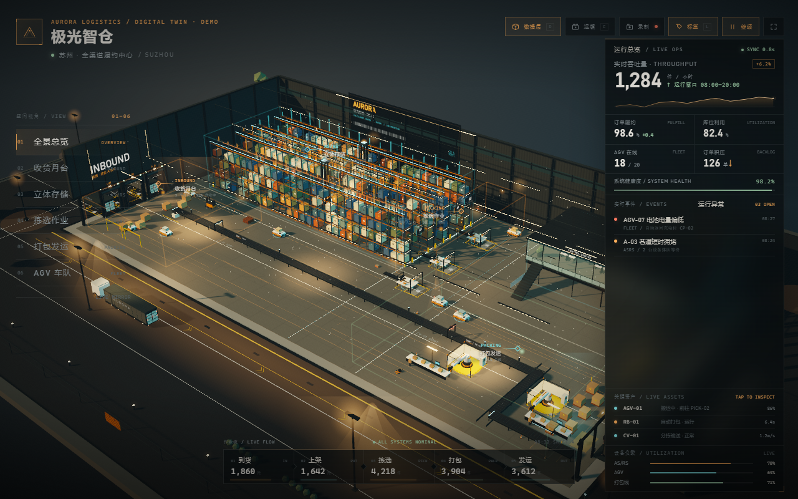

# AURORA DC-01 · 极光智仓数字孪生

一个可直接双击运行的 3D 数字孪生智慧仓储演示。单文件离线 HTML，three.js r160 内联，无 CDN / 外部素材 / 后端。



## 项目概况

- **场景**：剖切式高密度仓，464 库位 AS/RS、2 台双立柱堆垛机、3 个 G2P 拣选站、108m 输送线、2 台六轴打包机器人、8 台 AGV、充电区、中控夹层与收发月台。
- **运镜**：120 秒一镜到底，11 个章节；收货、巷道、拣选、输送、机器人、中控、发运、AGV 共 8 个工段特写，每段 4–9 秒近景停留。
- **录制**：纯 3D / 保留数据 UI / 保留运镜界面三种模式，结束自动保存。
- **交互**：6 个空间视角、设备详情、2D 小地图、数据层、空间标签、AGV 跟随。
- **实现**：程序化几何与 Canvas 纹理、HDR + 4×MSAA + Bloom、DOM HUD；1280×800 桌面环境约 50–60fps。
- 所有运营数据为虚构 **DEMO**。

## 运行

直接双击 `smart-warehouse-3d.html`，或：

```powershell
Start-Process .\smart-warehouse-3d.html
```

`?cine=1` 自动进入运镜。

## 提示词

- [简版提示词](AURORA-PROMPTS.md#simple-prompt)
- [详细版提示词](AURORA-PROMPTS.md#detailed-prompt)
